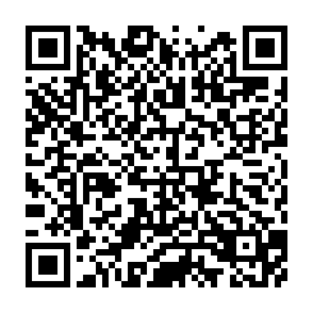

# Shield DJ Lite

**CODEX WAS USED TO GENERATE THE CODE**

Codex is an AI coding assistant from OpenAI. I choose the features and test the apps on my 3DS.

Lecteur MP3 et OGG pour console 3DS, pensé pour les modèles Old 3DS. Il lit les fichiers de la carte SD avec lecture aléatoire, réglage de vitesse et de pitch liés, basses, filtres et réverbération facultative. L’interface est disponible en français et en anglais. Un guide apparaît au premier lancement ; maintenir **SELECT** au démarrage le rouvre.


**SHIELD DJ Lite possède les mêmes fonctionnalités audio que [SHIELD DJ Standard](https://github.com/Shield-77/Shield-DJ-standard-), avec une interface minimaliste qui réduit la charge graphique.**


La [release v1.7.6](https://github.com/Shield-77/Shield-DJ-Lite/releases/tag/v1.7.6) distribue [`ShieldDJLite.cia`](https://github.com/Shield-77/Shield-DJ-Lite/releases/download/v1.7.6/ShieldDJLite.cia). La v1.7.6 rétablit la fonction normale de HOME, déplace Audio Boost dans les options SELECT et améliore le guide et l’organisation des fichiers MP3/OGG. Le CIA v1.7.4 (Title ID `000400000A210100`, version interne **1123**) ajoutait une réverbération longue facultative et corrigeait l’affichage du temps lorsque le pitch change. Les anciennes notes sont dans [CHANGELOG.md](CHANGELOG.md).

**État du code public :** le code C correspond au dossier local de v1.7.6, dont le CIA est identique octet pour octet à celui de la release publique (SHA-256). Le Makefile indique la version interne **1125**. Cette comparaison ne remplace pas une reconstruction indépendante ; les différences de ressources sont détaillées plus bas.

## Télécharger / Download

**[ShieldDJLite.cia (v1.7.6)](https://github.com/Shield-77/Shield-DJ-Lite/releases/download/v1.7.6/ShieldDJLite.cia)** · [Toutes les releases](https://github.com/Shield-77/Shield-DJ-Lite/releases)

FBI : Remote Install > Scan QR Code.



## Utilisation

Placez vos MP3 ou OGG Vorbis à la racine de la carte SD ou dans vos propres dossiers. SELECT ouvre les options pendant la lecture ; maintenir SELECT au démarrage permet de revoir le guide. La lecture peut continuer avec le clapet fermé.

## Why Shield DJ?

Well, it all started with a simple problem.

Listening to music smoothly. Like, just listening to music without any problems.

I always end up with the phones offered in Orange deals. You know, those offers where you take a specific subscription for three years and get something like 70% off a phone, or pay just €20 for it.

The problem?

Well, these phones can have an incredible CPU, an incredible GPU, but either terrible RAM or barely any RAM at all.

And me? I've had several phones like this.

Right now, I have a Samsung Galaxy A16.

A powerful CPU capable of handling Splatoon emulation, a good GPU, 4 GB of RAM...

And an incredibly slow environment.

So slow that I don't even dare listen to music on it anymore.

Because as soon as it starts lagging, the audio output completely glitches and goes full volume through the speakers.

And since I listen to Splatoon music and spend a lot of time on public transport, you can probably imagine the problem.

If the phone starts buffering or slowing down, well...

This poor phone sometimes switches to speakerphone without asking and blasts the volume.

Anyway.

That's when the 3DS started to interest me.

It's honestly a bit shameful for a phone from a big brand to get wrecked by an old 3DS.

A console from 2011.

Despite its small 268 MHz CPU (I'm saying this off the top of my head, maybe I'm mistaken), it's still performing pretty well.

128 MB of RAM, no crashes, good music quality, and I can even adjust the pitch based on the speed.

Decent, right?

Remember, it's a tiny CPU.

But it's cool.

Anyway, these days I only listen to music on my 3DS.

So whether you're poor and phoneless, or stuck on your 3DS because the current global economy is terrible, you're welcome in the SHIELD ecosystem!

Well, if you can call it that.


## Source et compilation

Le [code C de v1.7.6](source/) et les [en-têtes](include/) accompagnent la release v1.7.6. La copie publique utilise un écran inférieur SHIELD de remplacement et une bannière silencieuse : **le CIA officiel conserve son illustration créditée et son effet sonore d’origine**. Le fichier audio `S_Inkopolis_News.mp3`, inutilisé pour la compilation, reste uniquement dans la copie privée. Aucune de ces ressources privées n’est nécessaire pour compiler le source public.

Installer devkitPro/devkitARM, libctru, Tremor et libogg pour 3DS. Obtenir séparément `makerom` et `bannertool`, puis lancer :

```sh
make cia MAKEROM=/chemin/makerom BANNERTOOL=/chemin/bannertool
```

Le résultat est `build/ShieldDJLite.cia`. Son visuel inférieur et son son de bannière diffèrent du CIA officiel. Le code, la version interne et le Title ID restent ceux de v1.7.6. Les binaires des outils de construction ne sont pas redistribués ici.

## Licence et crédits

Le code original de Shield DJ Lite est sous [GNU GPL version 3 uniquement](LICENSE). La déclaration du projet figure dans [NOTICE.md](NOTICE.md). Les composants tiers gardent leurs propres licences : [minimp3 CC0](LICENSES/minimp3-CC0.txt), [Tremor](LICENSES/tremor-COPYING) et [libogg](LICENSES/libogg-COPYING). Le nom et les logos SHIELD identifient la publication officielle ; un fork doit indiquer son origine et ses changements sans se faire passer pour Shield-77.

L’illustration de Callie de l’écran inférieur du CIA officiel est créditée à **kamrikeen**. Elle n’est pas incluse dans ce dépôt source public ; aucune autorisation de redistribution de cette œuvre n’est documentée ici.
